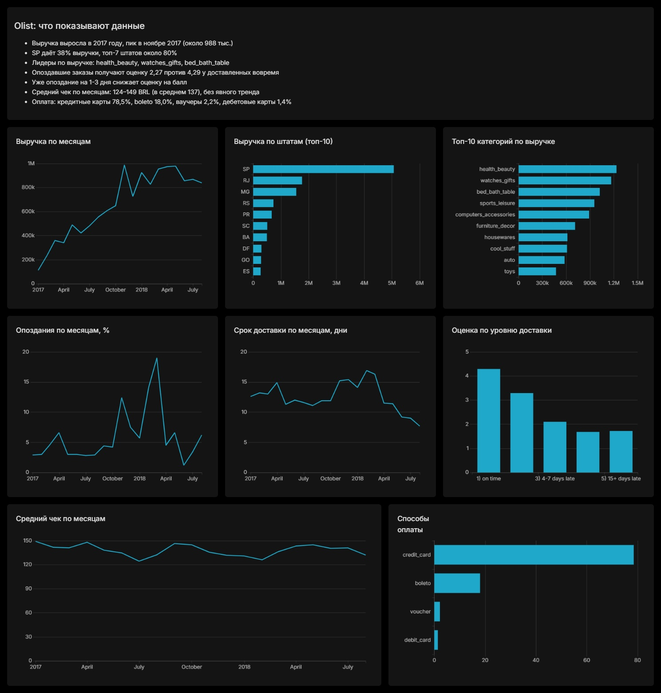
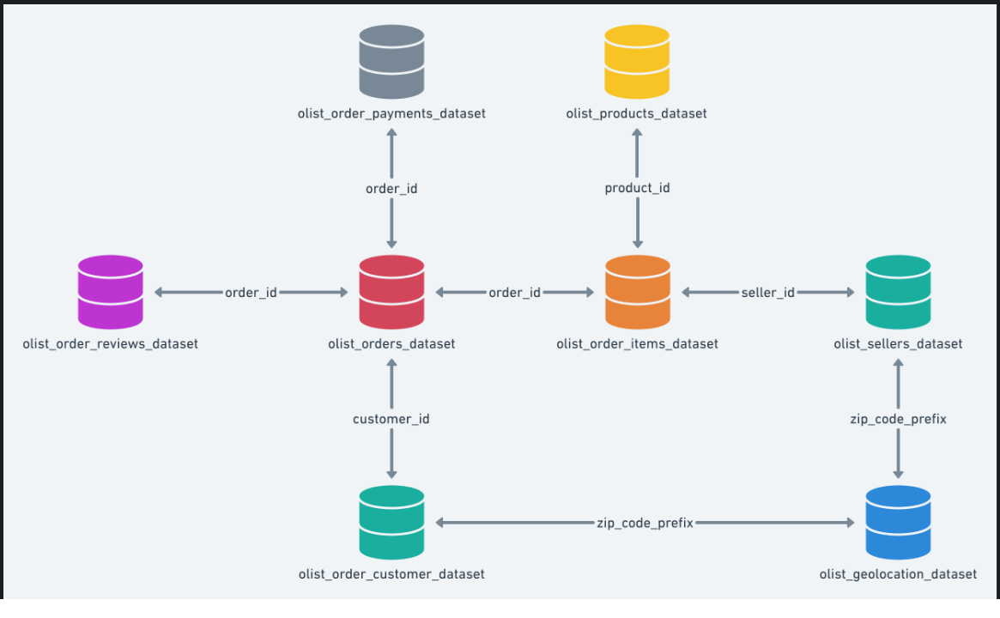

# Olist: анализ продаж, доставки и оценок покупателей

Учебный аналитический проект на открытом датасете бразильского маркетплейса Olist (Brazilian E-Commerce Public Dataset, Kaggle). Данные загружены в PostgreSQL, анализ написан на SQL, результаты собраны в дашборд Apache Superset.



## Вопросы проекта

1. Как менялись заказы и выручка по месяцам?
2. В каких штатах покупают больше всего?
3. Какие категории товаров приносят больше всего денег?
4. Сколько занимает доставка и как часто заказы опаздывают?
5. Как опоздания связаны с оценками покупателей?
6. Каков средний чек и как покупатели платят?

## Ключевые выводы

Период анализа: январь 2017 – август 2018, только доставленные заказы (`order_status = 'delivered'`). Суммы в бразильских реалах (BRL).

- **Рост и сезонность.** Заказов в месяц стало больше с 750 в январе 2017 до 7 069 в январе 2018. Пик выручки в ноябре 2017: около 988 тыс. при 7 289 заказах. Возможное объяснение, «чёрная пятница», в данных напрямую не проверялось.
- **Концентрация по географии.** Штат Сан-Паулу (SP) даёт 38,3% выручки, на втором и третьем местах RJ (13,3%) и MG (11,7%). Топ-7 штатов из 27 приносят около 81% выручки.
- **Категории.** По выручке лидируют `health_beauty` (около 1,23 млн), `watches_gifts` (около 1,17 млн) и `bed_bath_table` (около 1,02 млн). По числу заказов первая `bed_bath_table` (9 272), а у `watches_gifts` меньше заказов (5 495), но выше выручка на заказ.
- **Доставка.** Обычно заказ доставляется за 11–15 дней, около 3–4% заказов опаздывают. Два сбоя: ноябрь 2017 (15,2 дня, 12,4% опозданий) и февраль–март 2018 (16,9 и 16,3 дня, 14,1% и 19,0% опозданий). С апреля 2018 сроки сокращаются.
- **Опоздания и оценки.** Это главный вывод проекта:

  | Доставка | Отзывов | Средняя оценка |
  |---|---|---|
  | Вовремя | 89 944 | 4,29 |
  | 1–3 дня позже | 1 856 | 3,29 |
  | 4–7 дней | 1 756 | 2,10 |
  | 8–14 дней | 1 452 | 1,68 |
  | 15+ дней | 1 345 | 1,72 |

  Опоздавшие заказы составляют около 6,7% отзывов и получают оценку ниже на два балла. Уже задержка на 1–3 дня снижает оценку почти на балл.
- **Средний чек** по месяцам колеблется в диапазоне 124–149 BRL (в среднем 137) без явного тренда: рост выручки идёт за счёт числа заказов, а не более дорогих покупок.
- **Оплата.** По сумме платежей: кредитные карты 78,5%, boleto 18,0%, ваучеры 2,2%, дебетовые карты 1,4%.

### Ограничения выводов

- Связь между опозданиями и оценками показана, но не доказана как причина: у опоздавших заказов могут чаще встречаться и другие проблемы.
- Последние месяцы периода могут выглядеть лучше реальности: заказы, которые ещё не были доставлены на момент выгрузки, в расчёт не попали.
- Доля опозданий считалась сравнением полных временных меток; при сравнении только дат значения могут быть немного ниже.
- Выручка по штату — по месту жительства покупателя; данных о населении нет, поэтому вывод «SP самый сильный рынок» верен по деньгам, но не по активности покупателей на душу населения.

## Данные

Данные взяты с Kaggle [Brazilian E-Commerce Public Dataset by Olist](https://www.kaggle.com/datasets/olistbr/brazilian-ecommerce)

9 таблиц в схеме `public`:

| Таблица | Содержимое | Строк |
|---|---|---|
| `olist_orders_dataset` | заказы и даты этапов доставки | 99 441 |
| `olist_order_items_dataset` | товарные позиции заказов, цена, доставка | 112 650 |
| `olist_order_payments_dataset` | платежи | 103 886 |
| `olist_order_reviews_dataset` | отзывы и оценки | 99 224 |
| `olist_customers_dataset` | покупатели | 99 441 |
| `olist_products_dataset` | товары и их характеристики | 32 951 |
| `olist_sellers_dataset` | продавцы | 3 095 |
| `olist_geolocation_dataset` | координаты по зип-кодам | 1 000 163 |
| `product_category_name_translation` | перевод категорий на английский | 71 |

Связи: `orders` — центр схемы; к нему по `order_id` подключены позиции, платежи и отзывы, по `customer_id` покупатели; позиции ведут к товарам (`product_id`) и продавцам (`seller_id`).


## Стек

- PostgreSQL 17
- DBeaver (загрузка данных и разработка запросов)
- Apache Superset (дашборд)

## Методология и заметки по качеству данных

- Зип-коды хранятся как `text`: в числовом типе пропадают ведущие нули (`01037`).
- Суммы приведены к `numeric(10,2)`: при импорте колонки с ценой получили тип `real`, что приводит к потере точности и ошибке в `round()`.
- Даты загружены как текст и приведены к `timestamp`.
- В таблице отзывов есть многострочные комментарии с кавычками, поэтому она загружалась командой `\copy` (формат CSV), а не импортом DBeaver.
- В геолокации есть точки с координатами за пределами Бразилии (выбросы), при построении карт их нужно отфильтровать.
- Выручка = сумма `price` из `order_items` (без стоимости доставки).
- Средний чек считается по заказу: сначала сумма заказа, затем среднее по заказам.
- Superset добавляет `LIMIT` к запросам графиков, и в одном случае это привело к очень медленному плану выполнения (вложенный цикл вместо хеш-соединения). Результат вынесен в отдельную таблицу `reviews_by_lateness`, и график строится на ней.

## Структура репозитория

```

├── README.md
├── docs/
│   ├── dashboard.jpg          # скриншот дашборда
│   └── schema.png             # схема связей таблиц
├── sql/
│   ├── 00_prepare_types.sql
│   ├── 01_revenue_by_month.sql
│   ├── 02_revenue_by_state.sql
│   ├── 03_revenue_by_category.sql
│   ├── 04_delivery_by_month.sql
│   ├── 05_reviews_by_lateness.sql
│   ├── 06_avg_check.sql
│   └── 07_payments.sql
└── superset/
    └── olist_dashboard_export.zip
```
